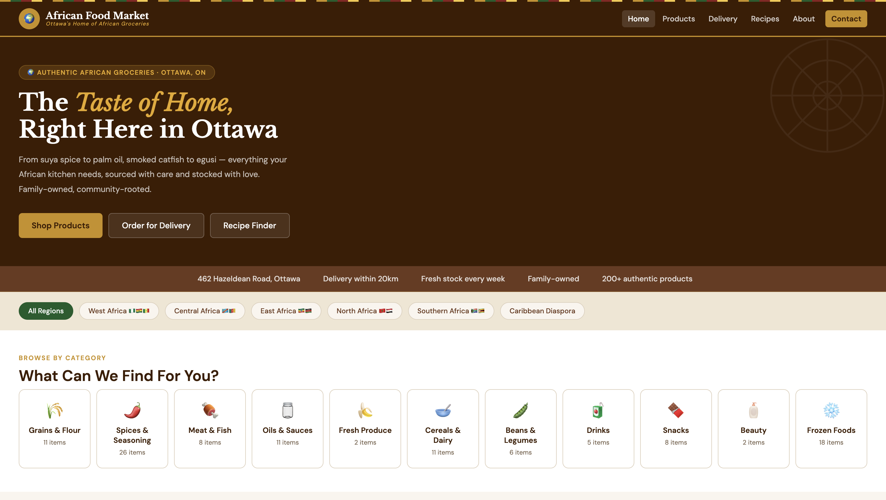

# African Food Market

A website for African Food Market, my family's African grocery store on Hazeldean Road in Kanata, Ottawa.

**Live site:** https://kosichukwuezi.github.io/African-Food-Market

## Features

- **Product catalogue:** 230 products across 11 categories, with search, category filters, and a pop-up for each product with sizes and prices
- **Delivery calculator:** customers enter their address, and the site matches it to an Ottawa neighbourhood or postal code, estimates the distance from the store, and shows the delivery fee, the minimum order for that zone, and how much more they need to spend for free delivery
- **Recipes:** traditional dishes with their ingredients, showing which ones are in stock at the store
- Separate pages for products, recipes, delivery, about, and contact

## Built with

HTML, CSS, and JavaScript, with no frameworks. Product and recipe data are stored in JavaScript arrays, so new items can be added without changing the page layout.
## Notes

I used AI tools to help draft and debug parts of this project. I designed the features, tested everything, and can walk through how the code works.

## Running it locally

Clone the repo and open `index.html` in a browser.

## What's.next
- Replace placeholder images with photos of the store's own products
- Use a maps API for exact delivery distances instead of a neighbourhood lookup table
- Connect the contact form so messages are actually sent
